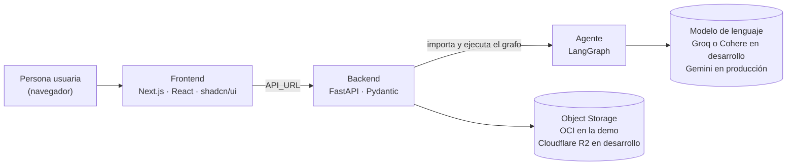
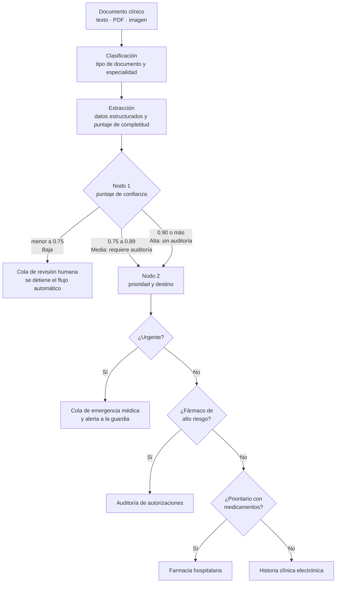

# MediFlow

**Agente autónomo para triaje, extracción y enrutamiento de documentos clínicos.**

Hackathon ONE G10 · Oracle Next Education & Alura · Equipo 19 (G10-LATAM)

Video demo (Pendiente)

> Proyecto educativo que trabaja solo con datos sintéticos. No reemplaza el criterio clínico.

---

## Contenido

- [El problema](#el-problema)
- [La solución](#la-solución)
- [Qué hace](#qué-hace)
- [Arquitectura](#arquitectura)
- [Flujo de decisión del agente](#flujo-de-decisión-del-agente)
- [Contrato de datos](#contrato-de-datos)
- [API](#api)
- [Cómo ejecutarlo](#cómo-ejecutarlo)
- [Casos de prueba](#casos-de-prueba)
- [Pruebas automatizadas](#pruebas-automatizadas)
- [Almacenamiento](#almacenamiento)
- [Cumplimiento del brief](#cumplimiento-del-brief)
- [Límites conocidos](#límites-conocidos)
- [Equipo](#equipo)

---

## El problema

La documentación clínica (informes, notas de evolución, recetas) llega sin estructura, y alguien tiene que leerla, clasificarla y decidir a dónde va. Ese proceso manual genera tres problemas:

- **Saturación administrativa:** clasificar a mano grandes volúmenes de documentos es un cuello de botella.
- **Latencia en la atención:** un proceso analógico retrasa estudios y tratamientos.
- **Falta de priorización:** sin una alerta temprana, una receta de rutina y una emergencia vital entran a la misma cola, y la emergencia depende de que alguien la descubra a tiempo.

A esto se suma el riesgo clínico de los datos omitidos: una dosis o una vía de administración que falta en una receta.

## La solución

MediFlow es un orquestador de triaje documental de **dos nodos**. Una IA extrae los datos del documento y luego dos nodos deciden qué hacer con él:

- **Nodo 1, filtro de calidad:** revisa que estén los datos esenciales (los «correctos de enfermería»: paciente, fármaco, dosis y vía) y calcula un puntaje de confianza con reglas matemáticas, no con la opinión del modelo. Si faltan datos críticos, frena el flujo automático y exige revisión humana.
- **Nodo 2, prioridad y destino:** evalúa la urgencia con parámetros de la Organización Mundial de la Salud, detecta medicamentos de alto riesgo y envía el documento al área correcta, generando una alerta si es una emergencia.

**La IA interpreta; las reglas clínicas deciden.**

## Qué hace

- Recibe documentos como texto pegado, `.txt`, `.json`, PDF con texto, PDF escaneado o imagen (JPG, PNG). Las imágenes y los PDF escaneados se transcriben con un modelo multimodal y la persona revisa el texto antes de procesarlo.
- Clasifica el tipo de documento (receta, informe de estudio, orden de procedimiento, epicrisis, certificado médico, etc.) y su especialidad.
- Extrae datos estructurados: paciente, médico, diagnóstico y CIE-10, medicamentos con dosis y vía, y signos vitales. Todo se valida con Pydantic.
- Calcula un **puntaje de confianza determinístico** a partir de los datos que faltan.
- Define la **prioridad** (Urgente, Prioritario o Rutina) con rangos de signos vitales de la OMS para adultos y para pediatría, señales de gravedad en el diagnóstico y apoyo de un modelo de lenguaje. Si las lecturas difieren, gana siempre la más grave.
- Desvía a **auditoría de autorizaciones** las recetas con fármacos de alto riesgo, aunque el puntaje sea perfecto.
- **Enruta** cada caso a su destino y guarda el documento y la decisión en un bucket, organizado por estado.
- Mantiene a una **persona en el circuito**: una cola de auditoría donde se aprueban o rechazan los casos dudosos.
- Ofrece una **interfaz web** con carga de documentos, detalle del triaje, historial con búsqueda, cola de auditoría y dashboard de métricas.

## Arquitectura



| Carpeta | Qué contiene | Documentación |
| --- | --- | --- |
| [`agente/`](agente/) | Grafo de decisión en LangGraph: clasificación, extracción, puntaje de confianza, prioridad y enrutamiento | [`agente/README.md`](agente/README.md) |
| [`backend/`](backend/) | API FastAPI, adaptador del agente y almacenamiento en buckets | [`backend/README.md`](backend/README.md) |
| [`front-end/`](front-end/) | Interfaz web en Next.js | [`front-end/README.md`](front-end/README.md) |
| [`schemas.py`](schemas.py) | Contrato de datos compartido (modelos Pydantic) | Ver [Contrato de datos](#contrato-de-datos) |

**Tecnologías:** Python, LangGraph, LangChain, Pydantic, FastAPI, Next.js 16, React 19, TypeScript, Tailwind CSS 4, shadcn/ui, Oracle Cloud Infrastructure Object Storage (capa Always Free) y Cloudflare R2.

## Flujo de decisión del agente



### Nodo 1: puntaje de confianza

El puntaje parte de 1.00 y se le resta un peso por cada dato faltante (medicamento, dosis o vía en una receta; unidad de edad; diagnóstico; edad; signos vitales incompletos, entre otros). Los pesos los definió el equipo de Datos y están en [`agente/confidence.py`](agente/confidence.py).

| Puntaje | Confianza | Qué ocurre |
| --- | --- | --- |
| menor a 0.75 | Baja | Se detiene el flujo automático y el caso va a **revisión humana**. No se evalúa la prioridad. |
| 0.75 a 0.89 | Media | Continúa al Nodo 2 y **requiere auditoría humana**. |
| 0.90 o más | Alta | Continúa al Nodo 2 **sin auditoría**. |

### Nodo 2: prioridad y destino

Los rangos de signos vitales y las palabras clave están en [`agente/priority_config.json`](agente/priority_config.json), así que se pueden ajustar sin tocar el código.

| Prioridad | Señales (resumen) |
| --- | --- |
| **Urgente** | Diagnósticos de riesgo vital (infarto, TEP, ACV, sepsis, shock, entre otros) o signos vitales críticos: SpO2 menor a 90 %, frecuencia cardíaca o respiratoria fuera de rango, temperatura extrema (en lactantes, mayor a 38.0 °C). |
| **Prioritario** | Cuadros que requieren atención rápida (dolor agudo, fractura cerrada, infección, crisis hipertensiva) o signos vitales intermedios (SpO2 de 90 % a 94 %, por ejemplo). |
| **Rutina** | Controles, chequeos y documentos administrativos, con signos vitales normales. |

| Condición | Destino |
| --- | --- |
| Prioridad Urgente | `Cola_Emergencia_Medica`, con alerta a la guardia |
| Fármaco de alto riesgo (opioides, anticoagulantes, insulinas, antimicrobianos de uso restringido, psicotrópicos, citostáticos) | `Auditoria_Autorizaciones`, con auditoría humana aunque el puntaje sea alto |
| Prioritario con medicamentos de uso común y puntaje Alto | `Farmacia_Hospitalaria` |
| Prioritario con medicamentos y puntaje Medio | `Auditoria_Autorizaciones`: la dispensación directa exige confianza Alta |
| Rutina, o sin medicamentos | `Historia_Clinica_Electronica` |
| Puntaje Baja | `Cola_Revision_Humana` |

### Qué decide cada etapa

| Etapa | Cómo decide |
| --- | --- |
| Clasificación | Modelo de lenguaje, con salida estructurada validada por Pydantic. Si no puede producir una salida válida, falla de forma explícita en lugar de inventar una. |
| Extracción | Modelo de lenguaje, con salida estructurada validada por Pydantic. |
| Puntaje de confianza | Reglas determinísticas sobre los datos que faltan. |
| Prioridad | Reglas clínicas y apoyo del modelo de lenguaje. Gana la lectura más grave. |
| Fármacos de alto riesgo | Listas cerradas de medicamentos. |
| Enrutamiento | Reglas. |

## Contrato de datos

Toda la comunicación entre el agente, el backend y el frontend sigue los modelos Pydantic de [`schemas.py`](schemas.py).

> **Regla del equipo:** `schemas.py` existe en tres lugares (raíz, `agente/` y `backend/app/`) y los tres deben ser **idénticos**. Cualquier cambio se hace en la raíz, con autorización del equipo de Datos, y se copia igual a las otras dos ubicaciones.

Ejemplo abreviado de una respuesta de `POST /triage`:

```json
{
  "status": "procesados",
  "documento_id": "DOC-CLIN-2026-8942",
  "canal_origen": "Guardia_Emergencias",
  "clasificacion": {
    "tipo_documento": "Informe de Estudio",
    "especialidad": "Radiología / Neumonología",
    "nivel_prioridad": "Urgente",
    "score_confianza_clasificacion": 0.95
  },
  "datos_extraidos": {
    "paciente": { "nombre": "Carlos Eduardo Mendes", "edad": 52, "unidad_edad": "años", "sexo": "M" },
    "diagnostico_principal": "Tromboembolismo Pulmonar Agudo (TEP)",
    "cie10_sugerido": "I26.9",
    "signos_vitales": { "saturacion_oxigeno": 88, "frecuencia_cardiaca": 115 }
  },
  "decision_enrutamiento": {
    "destino_principal": "Cola_Emergencia_Medica",
    "requiere_auditoria_humana": false,
    "justificacion_enrutamiento": "Score 0.95, prioridad Urgente",
    "notificacion_generada": {
      "canal": "Alerta_Guardia_Medica",
      "mensaje": "ALERTA: caso Urgente detectado, score 0.95."
    }
  },
  "almacenamiento_oci": {
    "bucket": "mediflow-documentos-clinicos",
    "ruta_objeto": "procesados/DOC-CLIN-2026-8942.json",
    "status_backup": "exito"
  }
}
```

## API

La documentación interactiva está en `http://localhost:8000/docs` con el backend en marcha.

| Método | Ruta | Descripción |
| --- | --- | --- |
| `POST` | `/triage` | Procesa un documento clínico: lo guarda, ejecuta el agente y devuelve el triaje con la decisión de enrutamiento. |
| `POST` | `/ocr` | Transcribe una imagen o un PDF escaneado a texto. No guarda nada: el texto se revisa y luego se envía a `/triage`. |
| `GET` | `/triage` | Historial de documentos procesados. Con `?estado=auditoria_humana` devuelve solo la cola de auditoría. |
| `GET` | `/triage/{id}` | Detalle de un documento. |
| `POST` | `/triage/{id}/aprobar` | Aprueba un caso en auditoría y lo mueve a `validados`. |
| `POST` | `/triage/{id}/rechazar` | Rechaza un caso en auditoría. Queda marcado como rechazado. |
| `GET` | `/health` | Estado del servicio. |

## Cómo ejecutarlo

### Requisitos

- Python 3.10 o superior (recomendado 3.11 o 3.12)
- Node.js 20.9 o superior y pnpm
- Una clave de API de un proveedor de modelos de lenguaje (Groq, Cohere o Gemini)
- Un bucket de Cloudflare R2 o de Oracle Cloud Object Storage

### 1. Clonar

```bash
git clone https://github.com/No-Country-simulation/G10-Latam-Team-19.git
cd G10-Latam-Team-19
```

### 2. Agente

```bash
cp agente/.env.example agente/.env
```

Completar `agente/.env`. Para desarrollo con Groq:

```env
LLM_ENV=dev
LLM_DEV_PROVIDER=groq
GROQ_API_KEY=...
```

Para producción, `LLM_ENV=prod` y `GEMINI_API_KEY`. El detalle de modelos está en [`agente/README.md`](agente/README.md). La lectura de imágenes necesita un modelo con visión: Groq o Gemini (Cohere no sirve para ese paso).

### 3. Backend

```bash
cd backend
python -m venv .venv
# Linux o macOS: source .venv/bin/activate
# Windows (PowerShell): .\.venv\Scripts\Activate.ps1
pip install -r requirements.txt
cp .env.example .env
```

Completar `backend/.env`. Las variables principales:

| Variable | Descripción |
| --- | --- |
| `STORAGE_PROVIDER` | `r2` (Cloudflare R2) u `oci` (Oracle Cloud). Cambia el almacenamiento sin tocar código. |
| `R2_*` | Credenciales y bucket de Cloudflare R2. |
| `OCI_*` | Credenciales y bucket de OCI Object Storage. |
| `AGENTE_DIR` | Ruta a la carpeta del agente. Por defecto `../agente`, así que el backend debe lanzarse desde `backend/`. |

Levantar el servidor:

```bash
uvicorn app.main:app --reload --port 8000
```

Las claves del modelo de lenguaje van en `agente/.env`, no en el del backend. Más detalles en [`backend/README.md`](backend/README.md).

### 4. Frontend

```bash
cd front-end
pnpm install
cp .env.example .env.local   # API_URL=http://localhost:8000
npm run dev
```

La aplicación queda en <http://localhost:3000>. Sin `API_URL`, la interfaz entra en **modo demo** con datos de ejemplo y un aviso visible: no analiza los documentos.

### 5. Probarlo

Desde la interfaz, cargar uno de los [casos de prueba](#casos-de-prueba), o usar `http://localhost:8000/docs` para enviar un `POST /triage`. Con `STORAGE_PROVIDER` configurado, el resultado queda guardado en el bucket.

## Casos de prueba

Los cinco casos que definió el equipo de Datos. Los textos completos están en [`agente/tests/test_integration.py`](agente/tests/test_integration.py).

| # | Caso | Resultado esperado |
| --- | --- | --- |
| 1 | **Rutina:** control de salud anual, paciente asintomática, signos vitales normales | `Historia_Clinica_Electronica`, sin auditoría humana |
| 2 | **Emergencia:** dolor opresivo en el pecho, infarto agudo, SpO2 88 %, frecuencia cardíaca 135 | `Cola_Emergencia_Medica` con alerta, sin auditoría humana |
| 3 | **Fármaco de alto riesgo:** parche de fentanilo en cuidados paliativos | `Auditoria_Autorizaciones`, con auditoría humana |
| 4 | **Datos críticos ausentes:** amoxicilina sin dosis ni vía de administración | `Cola_Revision_Humana`: el puntaje es bajo y no se evalúa la prioridad |
| 5 | **Pediátrico:** lactante de 11 meses con fiebre y paracetamol con dosis y vía | `Farmacia_Hospitalaria`, sin auditoría humana |

Los casos 1, 2 y 4 cubren los tres escenarios que pide el brief: flujo estándar, urgencia médica y caso ambiguo derivado a revisión humana.

## Pruebas automatizadas

```bash
# Agente (desde la raíz del repositorio)
PYTHONPATH=agente:. python -m unittest discover -s agente/tests
# En PowerShell: $env:PYTHONPATH="agente;."

# Backend
cd backend && python -m unittest discover -s tests

# Frontend
cd front-end && npm test
```

Ninguna de esas pruebas necesita claves ni red: reemplazan el modelo de lenguaje y el almacenamiento por versiones simuladas.

Para correr el grafo completo con un modelo real contra los casos de Datos (consume llamadas de la API):

```bash
cd agente
PYTHONPATH=. python tests/test_integration.py                      # los cinco casos
PYTHONPATH=. python tests/test_integration.py caso_2_emergencia    # uno solo
```

## Almacenamiento

Los documentos se guardan en un bucket, en una carpeta por estado:

| Carpeta | Contenido |
| --- | --- |
| `recibidos/` | El documento tal como llegó, antes de procesarlo. |
| `procesados/` | El resultado del triaje de los casos que el agente resolvió solo. |
| `auditoria_humana/` | Los casos que esperan revisión. Un caso rechazado también queda aquí. |
| `validados/` | Los casos que una persona aprobó. |

En desarrollo se usa Cloudflare R2, y en la demo Oracle Cloud Infrastructure Object Storage (capa Always Free). Los dos están detrás de la misma interfaz, y se cambia entre ellos con `STORAGE_PROVIDER`.

## Cumplimiento del brief

| Requisito | Estado |
| --- | --- |
| Ingestión de documentos en texto, PDF o imagen | Cumplido |
| Clasificación automática con un modelo de lenguaje | Cumplido |
| Extracción de datos clínicos en JSON validado con Pydantic | Cumplido |
| Lógica de decisión condicional con casos ambiguos y urgentes (LangGraph) | Cumplido |
| Integración con OCI Object Storage (capa Always Free) | Cumplido |
| Demostración de tres escenarios: rutina, urgencia y revisión humana | Cumplido |
| Documentación con diagrama del flujo del agente | Este documento |
| Panel de auditoría Human-in-the-Loop (diferencial) | Cumplido, en Next.js |
| OCR y lectura multimodal (diferencial) | Cumplido, con un modelo multimodal |
| Despliegue completo en OCI Compute (diferencial) | Pendiente |

## Límites conocidos

- **El modelo de lenguaje puede equivocarse,** sobre todo al leer letra manuscrita o fotos borrosas. Por eso la transcripción exige revisión humana, el modelo marca `[ilegible]` en lugar de adivinar, y los datos que faltan bajan el puntaje de confianza.
- **Las reglas clínicas son una aproximación académica** basada en parámetros de la OMS. No fueron validadas en un entorno hospitalario.
- **Las palabras clave son literales:** una paráfrasis o una negación («se descarta TEP») puede escaparse a esa regla. El apoyo del modelo de lenguaje en el Nodo 2 mitiga el problema, pero no lo elimina.
- **Con puntaje bajo no se evalúa la prioridad.** Es una decisión de diseño del equipo de Datos: un documento con datos críticos ausentes siempre pasa por una persona.
- **Las alertas son una notificación dentro de la respuesta.** No se envían a Slack, Telegram ni correo.
- **La imagen original no se guarda** en el bucket: queda el texto transcripto, así que quien audita no puede compararlo con la foto.

## Equipo

| Integrante | Rol |
| --- | --- |
| Jairo Severo | Project manager. Agente: clasificación e integración del grafo |
| Seylin Arguijo | Agente: extracción y puntaje de confianza |
| Natalia Delgado | Agente: prioridad y enrutamiento. Frontend |
| Michelle Sutachan | Datos clínicos: reglas de triaje, umbrales y casos de prueba |
| Carlos Carrillo | Frontend |
| Saúl Ytusaca | Backend |
| Josue Laurente | Backend |

Gracias a Oracle Next Education, a Alura y a NoCountry por esta oportunidad.
