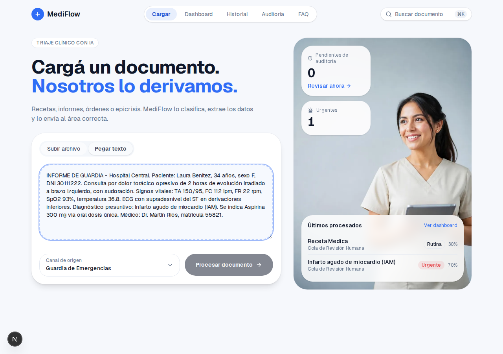
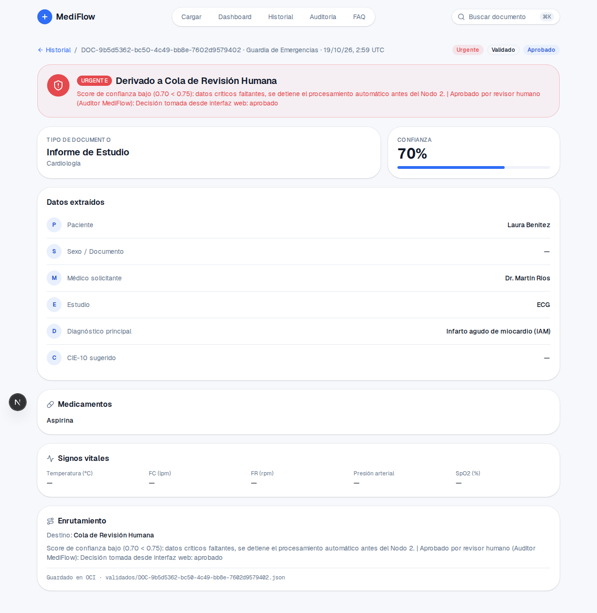
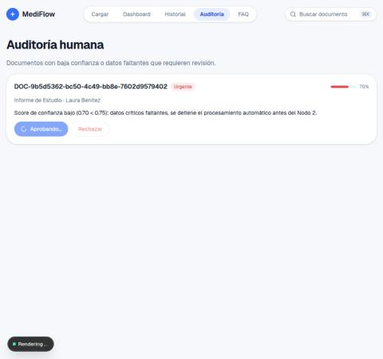
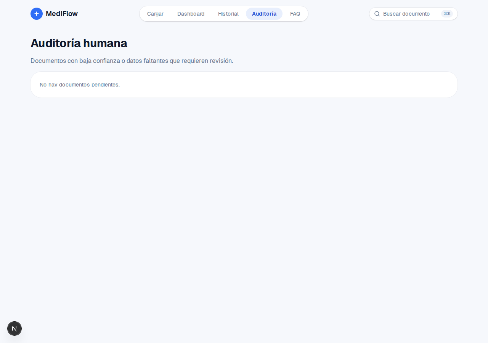
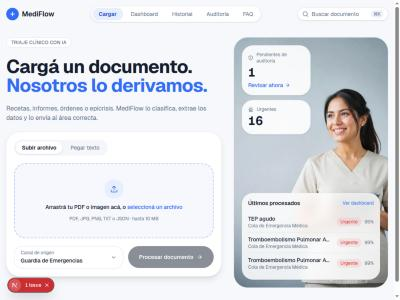
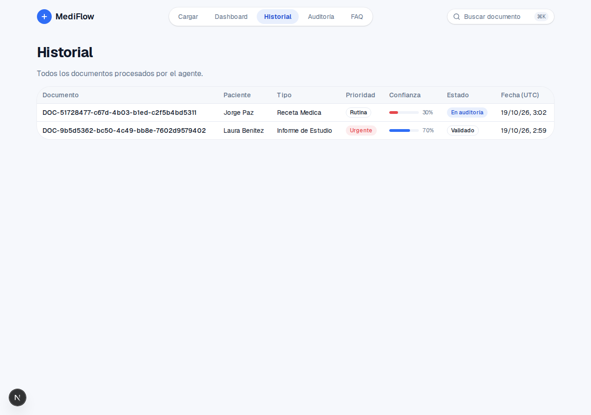
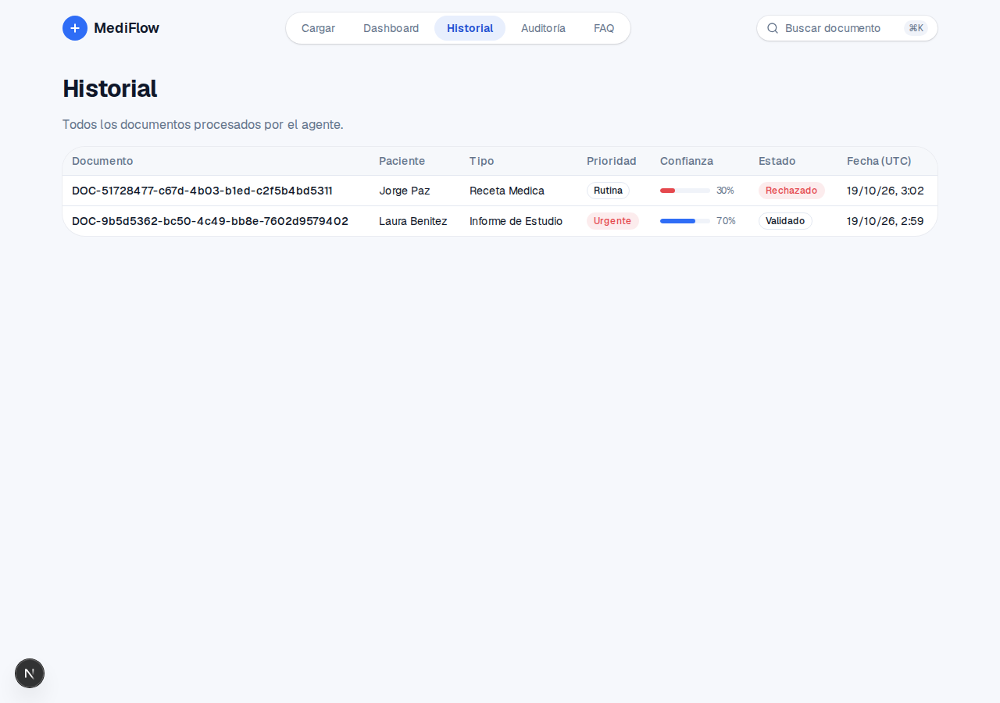
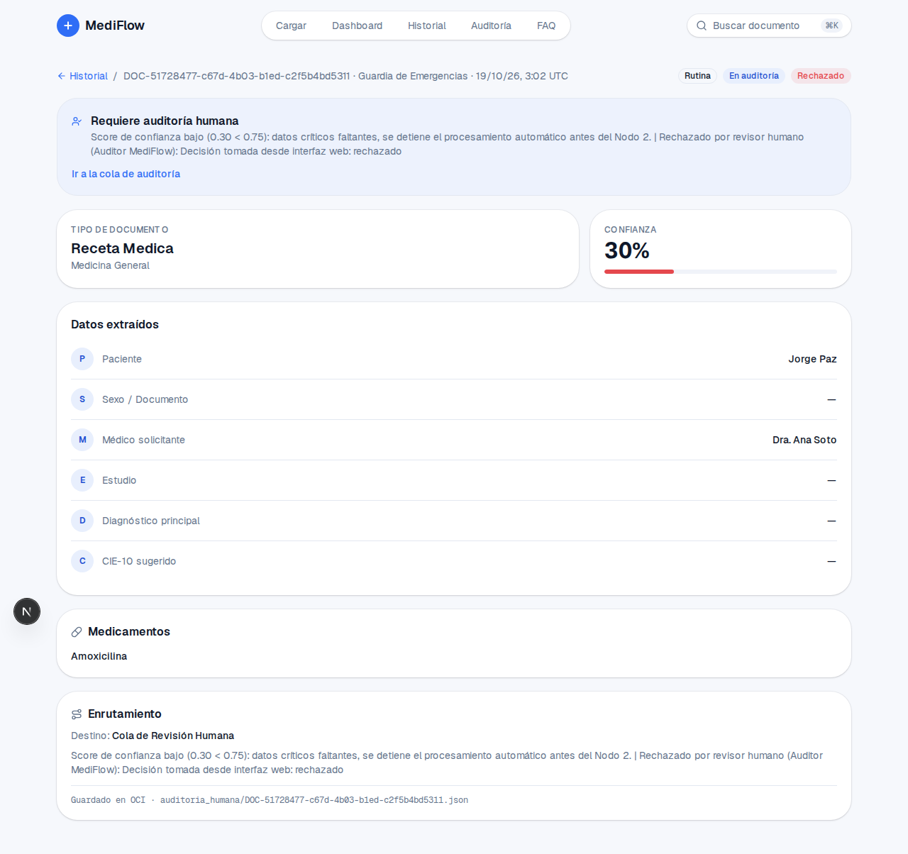
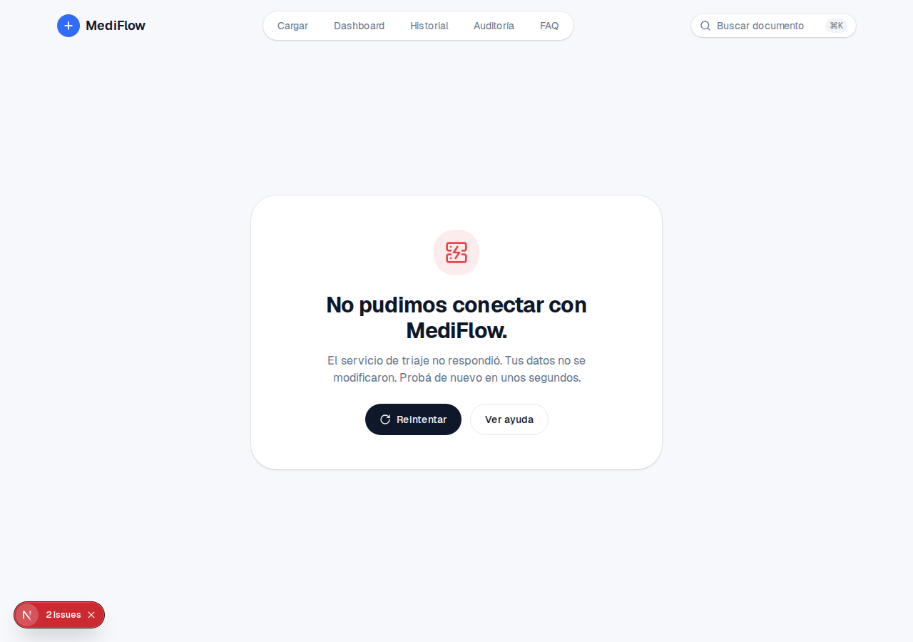
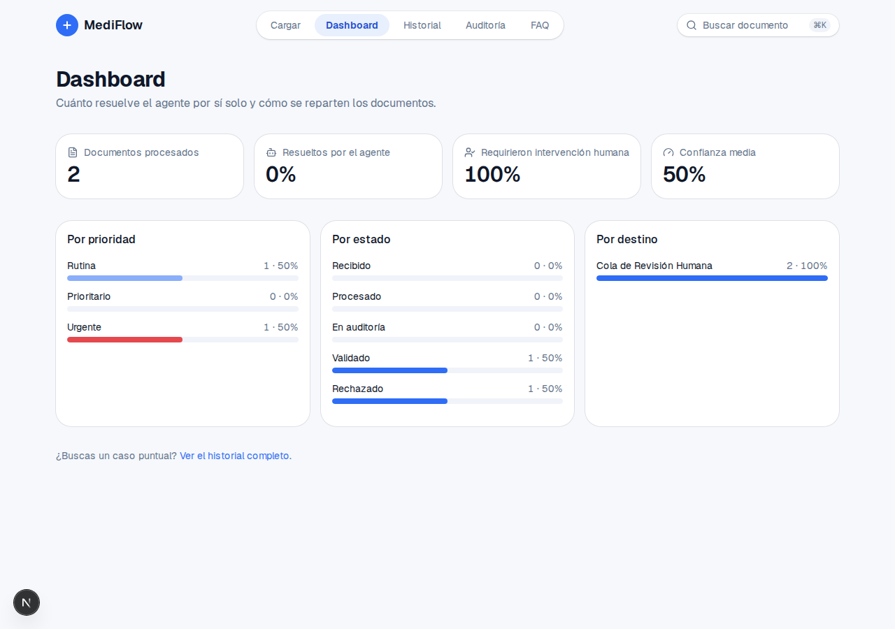

# Pruebas del flujo completo (front ↔ backend ↔ agente)

Pruebas realizadas por: **Natalia Delgado** (Frontend)

Fecha: 19/10/2026 · Rama: `feature/end-to-end` · Entorno: local (front `:3000`, backend `:8000`, LLM Groq, almacenamiento R2 + OCI).

## Resumen

**El flujo completo funciona:** se puede enviar un documento, ver el resultado real del triaje y aprobar o rechazar en auditoría con el estado actualizado en el backend.

| | Cantidad |
|---|---|
| ✅ Flujo validado | 5 |
| ✅ Problemas corregidos | 6 |
| ❌ Pendientes | 4 (2 alta · 2 baja) |

**Pendientes por responsable:** Backend 2 · Agente 1 · Por confirmar 1. Frontend no tiene pendientes.

Prioridad: 🔴 Alta (afecta la demo o pierde datos) · 🟡 Media (molesta, tiene salida) · 🟢 Baja (por confirmar o menor)

---

## 1. Pendientes (ordenados por prioridad)

| ID | Prioridad | Categoría | Subcategoría | Caso de prueba | Descripción | Resultado esperado | Cómo reproducir | Pruebas (lo que pasó) | Evidencia | Comentarios |
|---|---|---|---|---|---|---|---|---|---|---|
| P1 | 🔴 Alta | Backend | Almacenamiento | El historial lee un solo almacenamiento | `GET /triage` lee R2 y solo usa OCI si R2 está vacío | Se ven todos los documentos, estén en R2 o en OCI | Tener documentos en R2 y en OCI → abrir `/historial` | `DOC-TEST-ENDPOINT-180722` (está en OCI) desapareció de historial y auditoría; solo se ven los de R2 | [historial](capturas/despues-historial.png) | Mientras se arregla, usar un solo proveedor en `STORAGE_PROVIDER` evita el problema sin tocar código |
| P2 | 🔴 Alta | Agente | Extracción | Datos extraídos incompletos | El agente no extrae datos que sí están en el texto | Edad, sexo, DNI, signos vitales, dosis y matrícula completos | Enviar el informe de la [captura de carga](capturas/flujo-carga-texto.png) | Sexo/DNI, CIE-10 y todos los signos vitales en "—"; la confianza baja y casi todo cae en auditoría | [carga](capturas/flujo-carga-texto.png) vs [detalle](capturas/flujo-detalle-aprobado.png) | Sospecha (sin confirmar): `GROQ_MAX_TOKENS=800` corta la respuesta del modelo |
| P3 | 🟢 Baja | Backend | Manejo de errores | El backend no distingue "límite del LLM" de un error real | Si el proveedor del LLM rechaza por límite de uso (429), el backend responde 502 genérico. El límite en sí es del plan gratuito de Groq usado en las pruebas, no un bug | Responder 503/429 con un mensaje claro ("servicio ocupado, intentá en un minuto") para que el front lo muestre | Con el plan gratuito, enviar 2 documentos en menos de un minuto | `POST /triage` respondió 502 y el front mostró "No se pudo procesar el documento. Intentá nuevamente." sin decir el motivo | [log](#log-de-p3) | Con un plan pago es poco probable en la demo. Ver la nota sobre `BadRequestError` |
| P4 | 🟢 Baja | Por confirmar | Conexión | "No pudimos conectar con MediFlow" intermitente | El front no recibe respuesta del backend en 10 s | Las páginas cargan siempre | No hay pasos fijos: pasó 3 veces | Las 3 veces coincidieron con recompilaciones de `pnpm dev` tras editar código; al recargar respondió normal y las peticiones no llegaron al log del backend. Confirmar si pasa sin editar código | — | Solo visto en desarrollo. Si se repite sin editar código, subir la prioridad |

> Nota para el equipo del Agente: antes del 429 de P3, la salida estructurada del modelo falló con `BadRequestError` y el agente reintentó, duplicando el consumo de tokens. Ese error no depende del plan y su detalle no queda en el log. No es urgente, pero conviene revisarlo.

---

## 2. Flujo validado

| ID | Categoría | Subcategoría | Caso de prueba | Descripción | Resultado esperado | Cómo reproducir | Pruebas (lo que pasó) | Evidencia | Comentarios |
|---|---|---|---|---|---|---|---|---|---|
| F1 | Flujo | Carga | Enviar documento pegando texto | Enviar un informe clínico desde Cargar | El agente lo procesa y se abre el detalle | Cargar → Pegar texto → pegar un informe → Procesar documento | Procesado en ~15 s, redirige a `/triaje/DOC-…` | [carga](capturas/flujo-carga-texto.png) | Probado pegando texto. Subir archivo (PDF/imagen) no se probó |
| F2 | Flujo | Detalle | Resultado coincide con el backend | Comparar el detalle con `GET /triage/{id}` | Mismos datos, prioridad, destino y confianza | Abrir el detalle y comparar con `curl localhost:8000/triage/{id}` | Coinciden; confianza 70% = score 0.70 y 30% = 0.30 | [detalle](capturas/flujo-detalle-aprobado.png) | Probado con 2 documentos |
| F3 | Flujo | Auditoría | Aprobar un caso | Aprobar un documento de la cola | Sale de la cola; backend `status: validados`, `decision_auditoria: aprobado` | Auditoría → Aprobar | Sale de la cola y el backend lo mueve a `validados/`; el detalle dice "Validado" | [aprobando](capturas/flujo-auditoria-aprobando.jpg) · [cola vacía](capturas/flujo-auditoria-vacia.png) | El comentario del revisor queda agregado a la justificación |
| F4 | Flujo | Auditoría | Rechazar un caso | Rechazar un documento de la cola | Sale de la cola; backend `decision_auditoria: rechazado` | Auditoría → Rechazar | Sale de la cola y el backend guarda `rechazado`; el front lo muestra como "Rechazado" (ver C2) | [detalle](capturas/despues-detalle-rechazado.png) | El documento queda en `auditoria_humana/`: no existe carpeta de rechazados |
| F5 | Flujo | Historial / Dashboard | Listado y métricas con datos reales | Ver historial, home y dashboard contra el backend | Muestra los documentos reales sin errores | Abrir `/historial`, `/` y `/dashboard` | Funciona (después de limpiar los duplicados, ver C1) | [historial](capturas/despues-historial.png) · [dashboard](capturas/despues-dashboard.png) | La búsqueda del dashboard queda para después de la integración |

---

## 3. Corregidos

| ID | Categoría | Subcategoría | Caso de prueba | Descripción | Resultado esperado | Cómo reproducir | Pruebas (lo que pasó) | Evidencia | Comentarios |
|---|---|---|---|---|---|---|---|---|---|
| C1 | Backend | Datos | Documentos duplicados en el bucket | 5 `TEST-DOC-*` guardados en 3 carpetas como `{id}-{estado}.json` | Cada documento aparece una sola vez | Abrir `/historial` (antes de la limpieza) | Salían 3 veces (16 "urgentes"), error de React por keys repetidas y detalle 404. **Corregido:** se borraron los 15 duplicados (copia en `~/01-proyectos/G10-backup-bucket-hackathon-alura-2026-10-18/`) | [antes](capturas/antes-home-duplicados.jpg) | Eran datos de prueba de una versión vieja; las 3 copias eran idénticas |
| C2 | Frontend | Estados | Un rechazado debe verse como "Rechazado" | El backend deja el rechazado con `status: auditoria_humana` + `decision_auditoria: rechazado`; el front mostraba "En auditoría" (reporte del equipo, caso Elena Beatriz) | "Rechazado" en historial, detalle y dashboard; no cuenta como pendiente | Rechazar un caso → ver historial, detalle, dashboard y home | **Corregido solo en el front** (`estadoVisible`): dice "Rechazado" en todas las pantallas, el detalle muestra "Rechazado por revisor humano", el dashboard tiene la fila "Rechazado" y pendientes queda en 0 | [antes](capturas/antes-historial.png) · después: [historial](capturas/despues-historial.png), [detalle](capturas/despues-detalle-rechazado.png), [dashboard](capturas/despues-dashboard.png) | Reportado por el Carlos al priv. |
| C3 | Frontend | Detalle | Decía "Guardado en OCI" aunque estaba en R2 | La etiqueta salía del nombre del campo `almacenamiento_oci` | No mostrar un proveedor equivocado | Ver el final del detalle de un documento guardado en R2 | **Corregido:** dice "Guardado en almacenamiento" (el backend no informa el proveedor real) | [antes](capturas/antes-detalle-rechazado.png) · [después](capturas/despues-detalle-rechazado.png) | Si el backend informa el proveedor en la respuesta, se puede mostrar |
| C4 | Frontend | Tipos | `nombre` puede venir `null` | `paciente.nombre` y `medico_solicitante.nombre` estaban tipados como `string` | Tipos `string \| null` como en el backend | Ver `types/triage.ts` vs `backend/app/schemas.py` | **Corregido:** el historial muestra "—", la auditoría no deja un "·" colgando y el médico ya no puede mostrarse como "null · MP …" | Código | También evitaba que el médico se mostrara como "null · MP …" |
| C5 | Contrato | Canal de origen | Formato distinto del canal | El front mandaba `"Guardia de Emergencias"`, el agente usa `"Guardia_Emergencias"` | Un único formato | Enviar un documento y ver `canal_origen` en la respuesta | **Corregido:** se envía el formato del agente y en pantalla se ve "Guardia de Emergencias" (también con los documentos viejos) | [detalle](capturas/despues-detalle-rechazado.png) (encabezado) | Los documentos guardados con el formato anterior se siguen viendo bien |
| C6 | Frontend | Carga | Tras un error, el canal volvía al valor por defecto | Se reportó como "se pierde el texto si falla el envío". Reproducido con el backend caído y con un 502: el texto y la pestaña se mantienen, pero el canal elegido volvía a "Guardia de Emergencias" | Tras un error se mantienen texto, pestaña y canal para reintentar | Elegir "Farmacia" → enviar con el backend devolviendo error → mirar el canal | **Corregido:** el formulario se envía con `onSubmit` en vez de `action`, porque con `action` React resetea el formulario al terminar. Verificado: tras el error se mantiene "Farmacia", y un envío exitoso sigue redirigiendo al resultado (~5 s) | Reproducido con un script de Playwright (local, no está en el repo) | Sin el arreglo, un reintento salía con el canal equivocado sin que se notara. La pérdida total del texto del primer test no se volvió a reproducir |

---

## Capturas

### Pendientes

#### Log de P3

```
groq.RateLimitError: Error code: 429 - Rate limit reached for model `qwen/qwen3.8-27b` ... on output tokens per minute (OTPM): Limit 1000, Used 759, Requested 296.
RuntimeError: extraction_node: fallaron la respuesta estructurada y el parseo JSON alternativo. Tipos de error: BadRequestError y RateLimitError.
"POST /triage HTTP/1.1" 502 Bad Gateway
```

### Flujo

**Carga con texto pegado (F1, P2)**


**Detalle del caso aprobado (F2, F3, P2)**: Sexo/Documento, CIE-10 y signos vitales vacíos aunque el texto los tenía.


**Aprobando desde auditoría (F3)**


**Cola de auditoría vacía después de aprobar y rechazar (F3, F4)**


### Antes y después

**Antes · Home con duplicados (C1)**: 16 urgentes y "1 issue" de React.


**Antes · Historial (C2)**: el rechazado figuraba "En auditoría".


**Después · Historial (C2, P1)**: el rechazado figura "Rechazado". Falta `DOC-TEST-ENDPOINT-180722` (P1).


**Antes · Detalle del rechazado (C3)**: "En auditoría", "Requiere auditoría humana" y "Guardado en OCI".


**Después · Detalle del rechazado (C2, C3, C5)**: "Rechazado", aviso "Rechazado por revisor humano", "Guardado en almacenamiento" y canal legible.


**Después · Dashboard (C2, F5)**: fila "Rechazado" en "Por estado".

